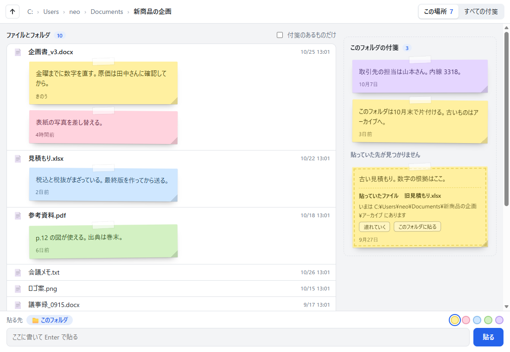
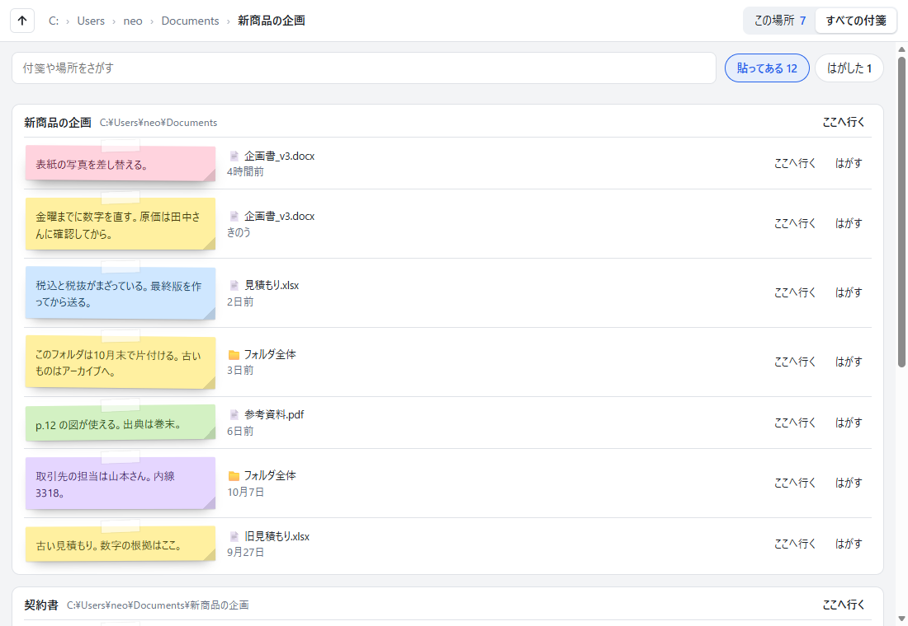

# ここ付箋

付箋を、ファイルやフォルダに貼ります。

付箋は、貼った場所のフォルダの中に保存されます。フォルダを動かしても、同期しても、いっしょに付いていきます。はがしても消えず、「すべての付箋」から戻せます。通信はしません。

[explorer_plus](https://github.com/Neptunity-git/explorer_plus) の MOD です。`neo.place-notes` 0.1.0。まだ 1.0 より前です。育てている途中なので、動きや保存の形が変わることがあります。





## 使いかた

使いかたは、「選んで、書いて、Enter」です。設定も、ファイルの準備も要りません。

| したいこと | 操作 |
|---|---|
| ファイルに貼る | 行を選んで、下の欄に書いて Enter |
| フォルダ全体に貼る | 何も選ばずに書いて Enter。右の「このフォルダの付箋」に出る |
| 子フォルダに貼る | そのフォルダの行を選んで書く |
| 書き直す | 付箋を押す。打つたびに自動で残る。Esc か外を押すと閉じる |
| 色を変える | 書き直しの中の色の丸 |
| 貼りなおす | 付箋をつかんで、別のファイルの行・フォルダの行・右の掲示板へ落とす。「元に戻す」が 8 秒出る |
| ずらす・大きさを変える | 付箋をつかんで動かす。右下の角をつかむと、大きさが変わる |
| 位置と大きさをもとに戻す | 付箋を右クリック |
| はがす | 付箋の「はがす」。消えない。「元に戻す」が 8 秒出る |
| 探す・戻す・消す | 上の「すべての付箋」。ことばで探す・はがした付箋を貼りなおす・完全に消す |
| ほかのビューから | 右クリックの「ここ付箋 › 付箋を貼る」と「付箋つきで開く」 |

## 付箋の置き場所

付箋は、貼った場所のフォルダの中の `.explorer_plus\view.neo.place-notes.json` に保存されます。

- ファイルに貼った付箋は、そのファイルがあるフォルダに入ります。
- フォルダ全体に貼った付箋は、そのフォルダ自身に入ります。
- 子フォルダに貼った付箋は、その子フォルダ自身に入ります。
- 付箋が 0 枚になると、データのファイルも消えます。
- `C:\` の直下のように書けないフォルダでは、本体がこのビューの保存場所に置きます。

## 入れ方

1. [Releases](https://github.com/Neo-Neptunity/place-notes/releases) を開き、いちばん新しい版の zip（`neo.place-notes-版.zip`）をダウンロードします。「Source code」ではなく、自分で付けた zip のほうです。
2. explorer_plus のホームの「MOD」の欄で「＋ MOD を入れる（zip）」を押して、zip を選びます。解凍はしません。
3. 確認の画面の「このビューが使う情報」を読んで、よければ入れます。

## 使う情報

| 使う情報 | 使いみち |
|---|---|
| `entries` | フォルダの中身を、行に出す |
| `icons` | Windows のアイコンを出す |
| `modified` | 更新日時を出す |
| `links` | ファイル ID から、今の場所を引く |
| `folderData` | 付箋を、そのフォルダの中に保存する |

## 設定

文字の大きさ・新しい付箋の色（きいろ・もも・みず・みどり・むらさき）・タブに付箋の数を出す。

## 作りかた

- [docs/design.md](docs/design.md)：設計書
- [dev/](dev/)：自動の試験と、画面を撮る道具。説明は [dev/README.md](dev/README.md)。そこに書かれたコマンドは、作者の置き場所から流す書き方です。このリポジトリでは、先頭の `place-notes/` を外して読んでください。

```
node dev/unit.mjs
```

Node.js だけで動きます。`dev/browser.mjs` は Edge か Chrome が要ります。

## ライセンス

[MIT](LICENSE)
